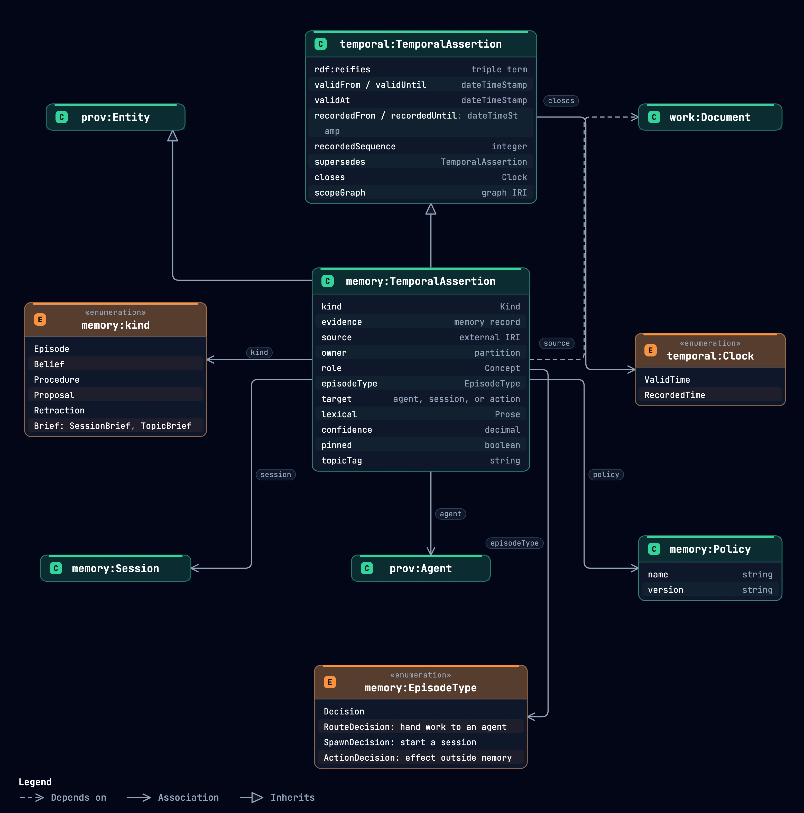

# Memory ontologies

These RDF vocabularies and SHACL shapes describe temporal assertions, agent memory, work, software, and the evidence. They define terms and constraints; they do not themselves store data, run inference, or enforce validation.



## Files

| File | Purpose | Namespace |
| --- | --- | --- |
| [temporal.ttl](ontologies/temporal.ttl) | Valid time, recorded time, graph scope, and supersession for an assertion. | `http://nova.dev/temporal#` |
| [temporal-shapes.shacl.ttl](ontologies/temporal-shapes.shacl.ttl) | SHACL constraints for temporal assertions. | `http://nova.dev/temporal#` |
| [memory.ttl](ontologies/memory.ttl) | Memory-specific terms for episodes, beliefs, procedures, proposals, retractions, and generated session and topic briefs. Uses the shared temporal vocabulary. | `http://nova.dev/memory#` |
| [memory-shapes.shacl.ttl](ontologies/memory-shapes.shacl.ttl) | SHACL constraints for memory records and their relationships. | `http://nova.dev/memory#` |
| [work.ttl](ontologies/work.ttl) | General vocabulary for agents, artifacts, work items, changes, and topics. | `http://nova.dev/work#` |
| [software.ttl](ontologies/software.ttl) | Software-specific terms, including repositories, source files, issues, commits, and dependencies. Builds on the work vocabulary. | `http://nova.dev/software#` |
| [answer-evidence-shapes.ttl](ontologies/answer-evidence-shapes.ttl) | SHACL constraints for cited answer evidence and inferred-evidence derivations, not for the underlying domain data. | `http://nova.dev/ns/answer-evidence#` |

The four ontology files include labels, definitions, and further modeling notes. All four declare version `0.2.0`. The namespace IRIs identify vocabulary terms; they are not a guarantee that an ontology can be downloaded from those addresses.

## Getting started

Load the relevant vocabulary files into an RDF-capable tool. For software data, load both `work.ttl` and `software.ttl`; for memory data, use `temporal.ttl` and `memory.ttl`. The files reference established vocabularies such as PROV, Dublin Core, and DOAP, but do not automatically import them. Load external vocabularies separately if your application needs their definitions or inferences.

For example, a software change can address an issue and modify a file:

```turtle
@prefix ex: <https://example.org/> .
@prefix work: <http://nova.dev/work#> .
@prefix software: <http://nova.dev/software#> .

ex:issue-42 a software:Issue .
ex:parser a software:SourceFile ;
    software:path "src/parser.rs" .
ex:commit-abc a software:Commit ;
    work:implements ex:issue-42 ;
    software:modifies ex:parser .
```

A reasoner that supports the relevant axioms can infer, for example, that the commit is a `work:Change` and the issue is a `work:WorkItem`. Available inferences depend on the reasoner and its configured profile. OWL domain, range, and subclass axioms are not validation rules; use SHACL or application checks for constraints.

## Time and memory

A `temporal:TemporalAssertion` is an identifiable record that refers to one triple. It uses RDF 1.2 `rdf:reifies` with a triple term or, in a store without triple terms, classic `rdf:subject`, `rdf:predicate`, and `rdf:object` on the record. The shapes accept either form, but not both on one record. The referenced triple is not automatically asserted as an ordinary fact. Valid time describes when that fact holds; recorded time describes when a store held the record. Valid-time intervals are half-open: the start is inclusive and the end exclusive. An instant uses `temporal:validAt` instead of interval endpoints.

Memory records add memory:kind and other memory-specific properties to temporal assertions. They use intervals beginning with temporal:validFrom, not temporal:validAt. Superseding records are separate resources.

### Closing a record

A record is never ended by editing it. A new record points at it with `temporal:supersedes` and names the clock it closes with `temporal:closes`. That closing record has its own recorded time and agent, so the close is itself a fact with a recorded time.

| Case | `temporal:closes` | Meaning |
|---|---|---|
| Supersession | `temporal:ValidTime` | The world changed. The earlier statement was true until the closing record's `temporal:validFrom`. |
| Correction | `temporal:RecordedTime` | The earlier record was a mistake. It was held until the closing record was recorded, and it was never true in the world. |
| Closure | `temporal:ValidTime`, `temporal:RecordedTime`, or both | A `temporal:Closure` ends the earlier record and asserts nothing in its place. It reifies no triple. |
| Retraction | `temporal:RecordedTime`, `temporal:ValidTime`, or both | A `memory:Retraction` is a closure that withdraws a memory record. |

A domain record that supersedes and carries no `temporal:closes` is a supersession. A closure and a memory record must name the clock. Domain records and memory records may both carry a correction.

A closure is typed both `temporal:TemporalAssertion` and `temporal:Closure`, because SHACL reads asserted types only. Do not restate the old triple to end it: that would assert the triple again.

```turtle
ex:price-end a temporal:TemporalAssertion , temporal:Closure ;
    temporal:supersedes ex:price-1 ;
    temporal:closes temporal:ValidTime ;
    temporal:validFrom "2026-12-01T00:00:00Z"^^xsd:dateTimeStamp .
```

`temporal:validUntil` and `temporal:recordedUntil` on the earlier record are stored copies of an end, derived from the closing record. A query as of recorded time *t* takes ends only from closing records recorded at or before *t*, and ignores a stored copy whose closing record was recorded after *t*. Otherwise a knowledge cut taken before the close was recorded would see the close. See `tests/valid/supersession-closes-valid-time.ttl`, `correction-closes-recorded-time.ttl`, `retraction-closes-recorded-time.ttl`, `domain-closure-ends-valid-time.ttl`, and the other `domain-*` fixtures.

### Partial use

You may use these property IRIs without the shapes, with the meanings given here. A store without RDF 1.2 triple terms can still conform: reify with `rdf:subject`, `rdf:predicate`, and `rdf:object` on the record instead of `rdf:reifies`. A closure uses neither form. Typing the record `rdf:Statement` is optional. Data that does not pass the shapes should not claim conformance. A store may keep recorded time as commit sequences rather than datetime literals; a portable RDF export must include the corresponding recorded-time coordinates. RDF 1.2 triple terms and rdf:reifies require compatible tooling.

Curated knowledge from outside memory, such as published reports or third-party briefs, is not a memory record. Keep it in its own graph, for example as `work:Document` resources linked to topics with `work:about`. A belief, procedure, proposal, or retraction can name such a resource with `memory:source`. `memory:evidence` stays reserved for memory records, so a reader can tell what was observed in a session from what came from an outside source.

```turtle
@prefix rdf: <http://www.w3.org/1999/02/22-rdf-syntax-ns#> .
@prefix xsd: <http://www.w3.org/2001/XMLSchema#> .
@prefix dcterms: <http://purl.org/dc/terms/> .
@prefix temporal: <http://nova.dev/temporal#> .
@prefix memory: <http://nova.dev/memory#> .
@prefix work: <http://nova.dev/work#> .
@prefix ex: <https://example.org/> .

ex:report-123 a work:Document ;
    dcterms:publisher ex:publisher ;
    work:about ex:release .

ex:belief-1 a temporal:TemporalAssertion ;
    rdf:reifies <<( ex:release ex:status ex:planned )>> ;
    memory:kind memory:Belief ;
    memory:evidence ex:episode-1 ;
    memory:source ex:report-123 ;
    temporal:validFrom "2026-11-01T12:00:00Z"^^xsd:dateTimeStamp .
```

A decision is an episode with `memory:episodeType memory:Decision` or a narrower type: `RouteDecision` (hand work to an agent), `SpawnDecision` (start a session), or `ActionDecision` (an effect outside memory). The narrower types name what was chosen with `memory:target` and cite the episodes or beliefs they rest on, never a brief. An action decision also names its `memory:policy`. `memory:agent` is the deciding agent; give that agent `prov:actedOnBehalfOf` for the accountable person. Running the action stays in the system that executes it. A later episode that reports the result cites the decision with `memory:evidence`.

## Validation

Load `temporal-shapes.shacl.ttl` to check temporal assertions. To check memory records, load **both** temporal and memory shape files: the memory shapes do not invoke the temporal shapes automatically. Include referenced records in the validation data when checking relationships such as evidence and supersession. A decision's target needs its type in the data: a `prov:Agent` for a route and a `memory:Session` for a spawn. If the type is missing, the decision fails validation. The answer-evidence shapes are a separate validation set.

SHACL validation is not a substitute for all application checks. For example, the temporal shapes cannot require the object of `rdf:reifies` to be a triple term, and timestamp comparisons depend on validator support for `xsd:dateTimeStamp`. Nova does not run the temporal and memory shapes on its memory write path. See the comments in each shape file for further limits.

`tests/run.sh` checks the temporal and memory shapes against the fixtures in `tests/valid` (must conform) and `tests/invalid` (must fail with the messages each file lists). It also runs the bitemporal cases in `tests/vectors`: a query that reads ends from closing records must return the expected beliefs for each valid time and recorded-time cut. It needs Apache Jena on `PATH`, or `JENA_HOME` set, from a release that reads RDF 1.2 triple terms (tested with 6.3.0 on Java 21).

## License

The ontologies, shapes, and documentation are licensed under the [Creative Commons Attribution 4.0 International License](https://creativecommons.org/licenses/by/4.0/) (CC BY 4.0). See [LICENSE](LICENSE).
